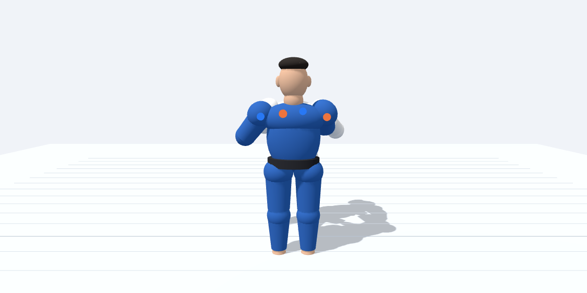
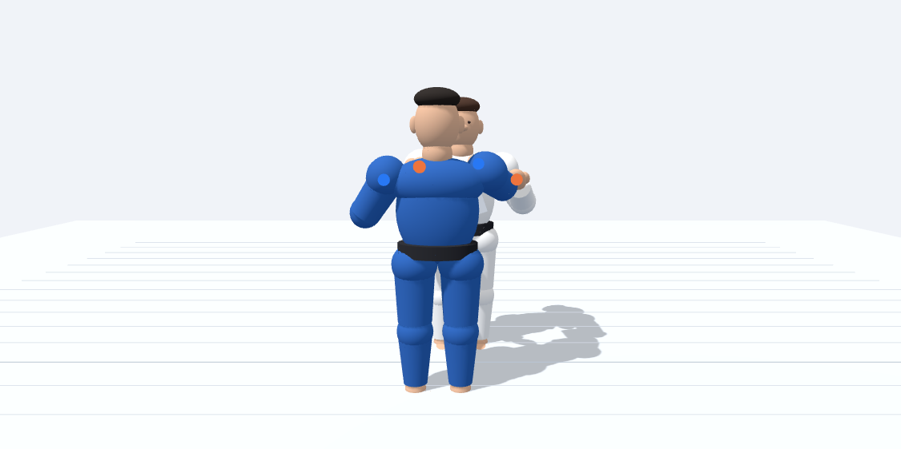
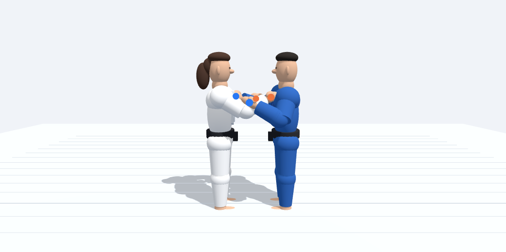
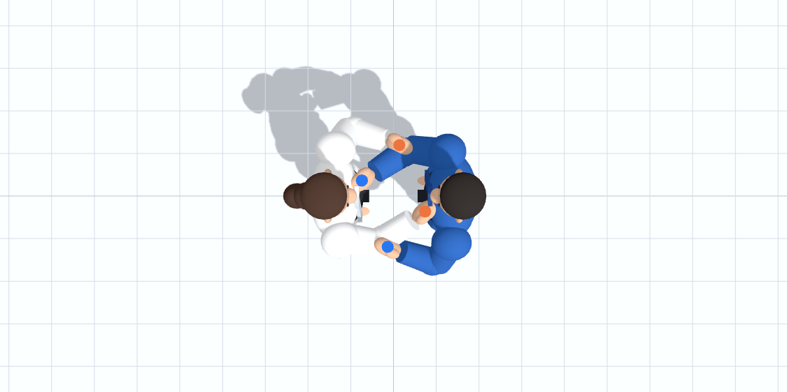
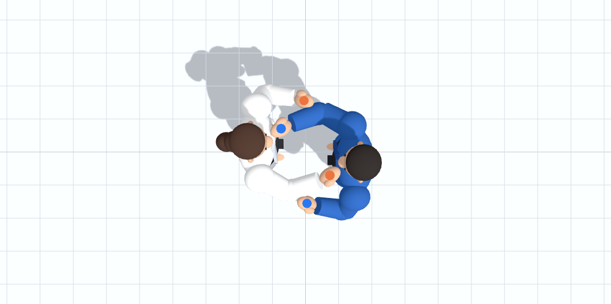

# Segunda revisión visual de Kumi-kata

Comparación de la postura de la primera revisión de esta rama con la postura
actual. Capturas de Chromium con las mismas cámaras. Tori lleva judogi blanco;
Uke, azul. La vista frontal sigue el eje entre ambos y la lateral los muestra de perfil.

| Vista | Revisión anterior | Postura actual |
| --- | --- | --- |
| Frontal |  |  |
| Lateral |  |  |
| Superior |  |  |

## Ajustes

- Hombros/codos con orientaciones distintas para solapa y manga; codos de manga
  relajados hacia abajo y fuera, conservando derecha/izquierda anatómica.
- Solapa algo más alta y manos de manga en la superficie exterior del antebrazo,
  independientes de su giro axial. Los destinos incluyen el espesor de la palma.
- Muñecas con 12° de flexión y orientación axial de 45° en solapa y 25° en manga,
  sin desviación lateral. El cálculo del brazo incluye este desplazamiento de la palma.
- Separación de 1,08 m entre raíces y pequeño desfase lateral de 20 cm entre judokas.

## Validación

Ejecutado `tests/visual_kumi_kata.py` en Chromium con Playwright, WebGL por software
y verificación TLS activada. Sin errores JavaScript.

- Cuatro palmas a menos de 5 mm de los puntos de contacto calculados.
- Separación mínima entre segmentos de los brazos de aproximadamente 25,2 cm,
  frente a 14,5 cm en la revisión anterior. Comprobación de segmentos complementada
  con inspección de las tres vistas; no es una prueba completa de colisiones de mallas.
- Lateralidad, límites de bisagra del codo y límites de muñeca.
- Edición de articulación, animación de dos fases hasta el 100 % y recuperación
  exacta de las rotaciones de la fase guardada.
- Exportación/importación JSON y recuperación de fases tras recargar.

Para repetir: instalar Playwright en el entorno de pruebas y disponer de Chromium.
Iniciar `python3 -m http.server 8000 --bind 127.0.0.1` en la raíz del repositorio y,
en otro terminal, ejecutar `python3 tests/visual_kumi_kata.py /tmp/judo-capturas`.
`CHROMIUM_PATH` permite seleccionar otro ejecutable. Si hay un proxy TLS, configurar
su CA en el almacén de confianza de Chromium; no desactivar la verificación.
La prueba usa un contexto temporal e instrumentación sólo en memoria, sin modificar
el HTML del repositorio. Genera las tres capturas y `metrics.json`.

## Limitaciones

Las manos siguen simplificadas, sin cierre articulado de dedos sobre tela. No hay
colisiones generales ni mantenimiento automático del contacto al editar libremente
o animar. Las fases antiguas pueden verse distintas por la corrección de lateralidad
y los límites articulares. La revisión visual y las medidas corresponden a la postura
inicial; no acreditan una simulación biomecánica o física completa.
